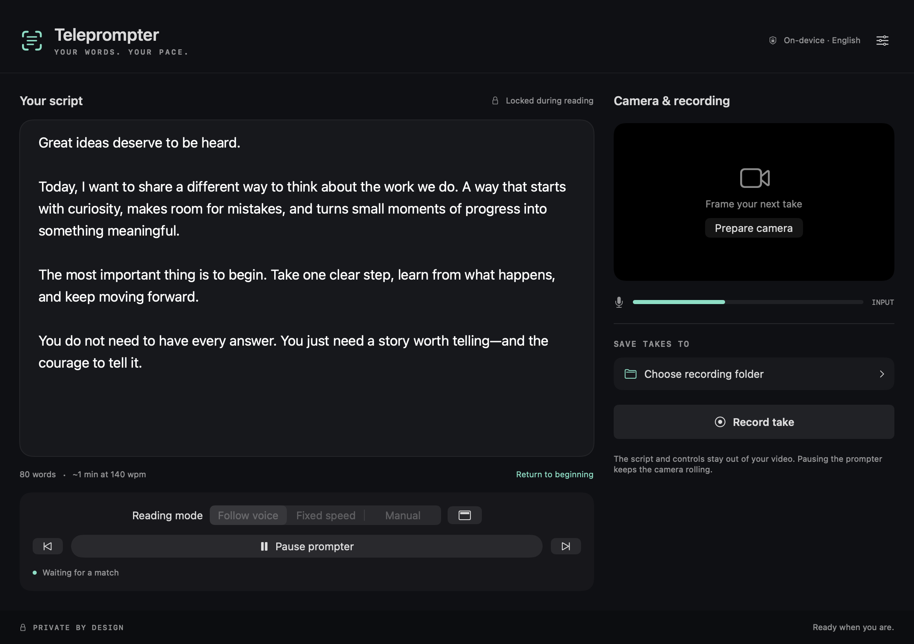
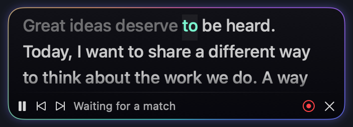

# Teleprompter

[](https://github.com/ssakhash/Teleprompter/actions/workflows/ci.yml)

A native macOS studio with a floating, voice-following reading panel and camera-to-MP4 recording. Built with Swift 6, SwiftUI, AppKit, AVFoundation, and Apple’s on-device Speech framework. No third-party dependencies or cloud API keys.



*Studio view with a sample script. The camera is off in this screenshot.*



*The floating panel follows your place in the script. Shown on a neutral background; its glow animates during use.*

## Features

- **Read near the camera.** A compact panel sits beneath the MacBook notch, remains visible across desktops, and can be repositioned for an external camera.
- **Follow your voice.** Local English speech recognition advances through the script, tolerates nearby restarts and skipped sentences, and holds during silence or ambiguous matches.
- **Record native camera quality.** Built-in and Continuity Camera discovery, camera/microphone selection, and H.264 video with AAC audio in MP4. Profiles prioritize native resolution, then frame rate.
- **Control the take.** Three-second countdown, rehearsal, manual sentence navigation, fixed-speed scrolling, configurable shortcuts, and menu bar controls. Pausing the text leaves recording running.
- **Keep work local.** Automatic draft saving, selected-folder access, and recovery of playable fragments from interrupted takes. No analytics or cloud recognition.

**Status:** version 1.0.3 is a release candidate. Automated tests and a short built-in camera recording have passed. Thirty-minute camera endurance and annotated human-speech acceptance remain open; see the [validation record](VALIDATION.md).

## Requirements

- Apple silicon Mac running macOS 26 or later.
- Xcode 26.6 or later to build.
- Camera and microphone permission, requested when you prepare the camera.
- English speech assets. The app displays download progress if macOS needs to install them. Manual and fixed-speed reading do not need speech assets.
- A folder you select for recordings.

## Build and run

Clone the repository and build:

```sh
git clone https://github.com/ssakhash/Teleprompter.git
cd Teleprompter
bash Scripts/build.sh
open build/Release/Teleprompter.app
```

Or open `Teleprompter.xcodeproj`, select the **Teleprompter** scheme, and run on **My Mac**. A clean checkout uses ad-hoc signing for local use. The build script produces the app, `build/Release/Teleprompter-macOS.zip`, and `SHA256SUMS`.

For a stable identity across local rebuilds, install an Apple Development certificate and configure your team:

```sh
cp Config/Local.xcconfig.example Config/Local.xcconfig
```

Edit `DEVELOPMENT_TEAM` in `Config/Local.xcconfig`. This file is ignored by Git; shared project settings contain no personal signing identity. Xcode command-line overrides take precedence, for example `bash Scripts/build.sh CODE_SIGN_IDENTITY=- DEVELOPMENT_TEAM=`.

Ad-hoc rebuilds or a change of signing identity can require renewed macOS camera, microphone, or app-data permission. Keep the same bundle identifier to preserve the app's draft/settings container.

Local builds and CI artifacts are for testing. For Developer ID signing, notarization, and distribution, follow the [release procedure](docs/RELEASING.md).

## Make a take

1. Paste your script into the editor. Drafts and preferences save automatically on your Mac.
2. Choose **Prepare camera** and allow camera/microphone access. Select the built-in camera or your iPhone, a microphone, and a quality profile.
3. Choose a recording folder. The quality selector shows actual device dimensions and frame rate; the first profile prioritizes resolution, then frame rate. Native aspect ratio is preserved, including square or 4:3 camera formats.
4. Use **Rehearse script** to try voice following. The panel stays near the camera while you switch apps. Drag its bottom bar to reposition it; reset its position from Settings or the Prompter menu.
5. Choose **Record take**. Following pauses during the three-second countdown and resumes when recording begins. The text and controls are excluded from the MP4.
6. **Pause prompter** pauses text only. **Stop & save take** finalizes the MP4. Play it or reveal it in Finder from the studio.

Voice following tolerates nearby restarts, skipped sentences, fillers, and small wording changes. It holds when a phrase is ambiguous or you go off-script. Click a displayed word or use sentence navigation to reposition; use **Return to beginning** for a fresh reading. Completing the script stops the prompter but leaves the camera recording.

Choose **Fixed speed** or **Manual** when voice following is unavailable. Configure text size, panel width, opacity, spacing, reading speed, and keyboard shortcuts in Settings.

The panel and script text use a compact layout at 60% of the original size, including existing saved preferences. At the default settings, the reading surface is 336 points wide with 16.8-point text. Settings shows the actual displayed dimensions. Recording controls retain their legible icon and status sizes.

The floating bubble has a gently rotating multicolor rim and a soft halo that responds to microphone level while following speech. Its text remains stationary apart from script advancement. A paused, idle panel stops its ambient animation, and hidden panels stop animating. Recording retains its separate red status indicator. Reduce Motion disables the moving light and animated scrolling, and Reduce Transparency gives the text an opaque background.

## Global shortcuts

Hold **Control + Option + Command** and press:

| Key | Action |
| --- | --- |
| R | Record / stop, or cancel preparation/countdown |
| P | Follow / pause the prompter |
| Left arrow | Previous sentence |
| Right arrow | Next sentence |

Shortcuts use registered system hotkeys, without keyboard monitoring or Accessibility permission. The menu bar provides the same controls.

## Privacy and recovery

Audio and transcripts stay on the Mac; macOS manages speech model installation and Continuity Camera transport. The application includes no network client, telemetry, or transcript logging. Only camera, microphone, and selected-folder sandbox entitlements are enabled.

The selected folder can contain hidden `.partial.mp4` files after interruption. **Incomplete takes → Recover** exports any playable fragments to a new MP4, preserving the source file. An abrupt exit before the first fragment may leave nothing recoverable. Do not delete a partial file until you have checked the recovered result.

## Verification

```sh
bash Scripts/test.sh
```

This runs the Swift tests and a generated three-second H.264/AAC recording through the same writer as the app. It does not access a camera or microphone. macOS media services must be available to the test process.

For a camera-configuration regression check, run `bash Scripts/check-camera-configuration.sh`. This exercises supported native frame timings, skips cameras already in use, and restores their original settings. It starts no capture session and records no media.

For an actual recording check, run `bash Scripts/check-recording.sh`. It uses fixture text and records approximately six seconds from the default camera and microphone with speech following enabled. It prints the resulting private temporary file path and media measurements. Allow any macOS permission prompts to proceed. Your saved draft, preferences, and recording-folder bookmark are not changed.

CI runs the core tests, synthetic MP4 integration check, Release build, signature verification, and package checksum check on macOS 26 with Xcode 26.6. Hosted CI does not replace camera, microphone, or desktop acceptance on physical hardware.

To refresh the screenshots, build the app and run `bash Scripts/screenshots.sh` in a logged-in macOS session. It renders the app's sample views and checks that the perimeter animation advances. It does not use the camera or microphone or modify saved drafts.

See [VALIDATION.md](VALIDATION.md) for measured results and reproducible speech/recovery checks, [ARCHITECTURE.md](ARCHITECTURE.md) for component boundaries, and [CHANGELOG.md](CHANGELOG.md) for version history.
